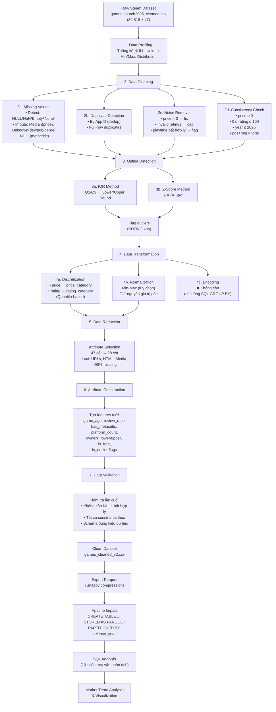

# 📋 KẾ HOẠCH PHÂN TÍCH TÍNH KHẢ THI VÀ ĐỀ XUẤT CẢI TIẾN
# Tiền xử lý dữ liệu Steam cho Apache Impala

> **Đề tài:** Phân tích dữ liệu trò chơi điện tử và khám phá xu hướng thị trường sử dụng Apache Impala bằng dữ liệu Steam
>
> **Vị trí dự án:** `D:\HocTap\HK1_27\BigData`

---

## A. DATASET STEAM ĐANG SỬ DỤNG

### A.1 Tổng quan bộ dữ liệu thực tế

| Dataset | File | Kích thước | Bản ghi | Cột |
|---------|------|-----------|---------|-----|
| **Games Metadata (Raw)** | `archive/games_march2025_cleaned.csv` | ~449 MB | ~89,618 | 47 |
| **Games Metadata (Full)** | `archive/games_march2025_full.csv` | ~450 MB | — | 47 |
| **Games May 2024** | `archive/games_may2024_cleaned.csv` | ~403 MB | — | 47 |
| **Games May 2024 (Full)** | `archive/games_may2024_full.csv` | ~405 MB | — | 47 |
| **Steam Reviews** | `archive/reviews-*.csv` (11 files) | ~5.3 GB | ~40,248,484 | 13 |

> [!NOTE]
> Dự án đang sử dụng file `games_march2025_cleaned.csv` làm nguồn chính — đây là phiên bản đã được source (Kaggle/ForgeMaster) sơ bộ lọc, **KHÔNG PHẢI** là dữ liệu raw hoàn toàn gốc. File `_full.csv` có thêm một số bản ghi chưa qua lọc.

### A.2 Cấu trúc 47 cột của Games Dataset (Raw)

| # | Thuộc tính | Kiểu dữ liệu | Mô tả | Phân loại |
|---|-----------|--------------|-------|----------|
| 0 | `appid` | INT | Mã định danh duy nhất trò chơi trên Steam | Khóa chính |
| 1 | `name` | STRING | Tên trò chơi | Định danh |
| 2 | `release_date` | STRING | Ngày phát hành (nhiều định dạng) | Thời gian |
| 3 | `required_age` | INT | Giới hạn độ tuổi | Phân loại số |
| 4 | `price` | FLOAT | Giá bán (USD) | Số liên tục |
| 5 | `dlc_count` | INT | Số lượng DLC | Số đếm |
| 6 | `detailed_description` | TEXT | Mô tả chi tiết (HTML) | Văn bản dài |
| 7 | `about_the_game` | TEXT | Giới thiệu về game (HTML) | Văn bản dài |
| 8 | `short_description` | TEXT | Mô tả ngắn | Văn bản |
| 9 | `reviews` | TEXT | Trích dẫn review trên trang store | Văn bản |
| 10 | `header_image` | STRING | URL hình ảnh đại diện | URL/Media |
| 11 | `website` | STRING | Website chính thức | URL |
| 12 | `support_url` | STRING | URL hỗ trợ | URL |
| 13 | `support_email` | STRING | Email hỗ trợ | Liên hệ |
| 14 | `windows` | BOOLEAN | Hỗ trợ Windows | Boolean |
| 15 | `mac` | BOOLEAN | Hỗ trợ macOS | Boolean |
| 16 | `linux` | BOOLEAN | Hỗ trợ Linux | Boolean |
| 17 | `metacritic_score` | INT | Điểm Metacritic (0-100) | Đánh giá |
| 18 | `metacritic_url` | STRING | URL trang Metacritic | URL |
| 19 | `achievements` | INT | Số thành tựu trong game | Số đếm |
| 20 | `recommendations` | INT | Số lượt đề xuất | Số đếm |
| 21 | `notes` | STRING | Ghi chú | Metadata |
| 22 | `supported_languages` | STRING | Danh sách ngôn ngữ hỗ trợ (list string) | Đa giá trị |
| 23 | `full_audio_languages` | STRING | Ngôn ngữ có audio đầy đủ | Đa giá trị |
| 24 | `packages` | STRING | Gói bán trên store (list) | Đa giá trị |
| 25 | `developers` | STRING | Nhà phát triển (list string) | Đa giá trị |
| 26 | `publishers` | STRING | Nhà phát hành (list string) | Đa giá trị |
| 27 | `categories` | STRING | Danh mục Steam (list string) | Đa giá trị |
| 28 | `genres` | STRING | Thể loại (list string) | Đa giá trị |
| 29 | `screenshots` | STRING | Danh sách URL ảnh chụp (list URL) | Media |
| 30 | `movies` | STRING | Danh sách URL video trailer (list URL) | Media |
| 31 | `user_score` | FLOAT | Điểm người dùng | Đánh giá |
| 32 | `score_rank` | STRING | Xếp hạng điểm | Xếp hạng |
| 33 | `positive` | INT | Số review tích cực | Số đếm |
| 34 | `negative` | INT | Số review tiêu cực | Số đếm |
| 35 | `estimated_owners` | STRING | Ước tính số người sở hữu (dải) | Phạm vi chuỗi |
| 36 | `average_playtime_forever` | INT | Thời gian chơi trung bình (phút) | Số liên tục |
| 37 | `average_playtime_2weeks` | INT | Thời gian chơi 2 tuần gần nhất | Số liên tục |
| 38 | `median_playtime_forever` | INT | Trung vị thời gian chơi | Số liên tục |
| 39 | `median_playtime_2weeks` | INT | Trung vị 2 tuần | Số liên tục |
| 40 | `discount` | INT | Mức giảm giá hiện tại (%) | Số phần trăm |
| 41 | `peak_ccu` | INT | Đỉnh người chơi đồng thời | Số đếm |
| 42 | `tags` | STRING | Thẻ do cộng đồng gắn (dict string→int) | Đa giá trị |
| 43 | `pct_pos_total` | INT | Tỷ lệ review tích cực tổng (%) | Phần trăm |
| 44 | `num_reviews_total` | INT | Tổng số review | Số đếm |
| 45 | `pct_pos_recent` | INT | Tỷ lệ review tích cực gần đây (%) | Phần trăm |
| 46 | `num_reviews_recent` | INT | Số review gần đây | Số đếm |

### A.3 Cấu trúc Reviews Dataset (13 cột)

| # | Thuộc tính | Kiểu dữ liệu | Mô tả |
|---|-----------|--------------|-------|
| 0 | `steamid` | BIGINT | Mã người dùng Steam |
| 1 | `appid` | INT | Mã trò chơi (FK → Games) |
| 2 | `voted_up` | BOOLEAN | True = Positive, False = Negative |
| 3 | `votes_up` | INT | Số lượt "hữu ích" từ cộng đồng |
| 4 | `votes_funny` | INT | Số lượt "hài hước" |
| 5 | `weighted_vote_score` | DOUBLE | Điểm trọng số tin cậy review |
| 6 | `playtime_forever` | INT | Tổng thời gian chơi (phút) |
| 7 | `playtime_at_review` | INT | Thời gian chơi khi viết review |
| 8 | `num_games_owned` | INT | Số game sở hữu của reviewer |
| 9 | `num_reviews` | INT | Tổng review đã viết |
| 10 | `review` | TEXT | Nội dung review (văn bản) |
| 11 | `unix_timestamp_created` | INT | Unix timestamp tạo review |
| 12 | `unix_timestamp_updated` | INT | Unix timestamp cập nhật |

---

## B. PHÂN TÍCH DỮ LIỆU BAN ĐẦU – DATA PROFILING

### B.1 Bảng Data Profiling tổng hợp (Games Dataset – 47 cột, **89,618 bản ghi**)

> [!IMPORTANT]
> Dữ liệu dưới đây là **kết quả profiling thực tế** chạy trên toàn bộ file `games_march2025_cleaned.csv` (~449 MB).

| # | Thuộc tính | Kiểu DL | NULL/Empty | % NULL | Unique | Min | Max | Ghi chú |
|---|-----------|---------|-----------|--------|--------|-----|-----|---------|
| 0 | `appid` | INT | 0 | 0% | 89,618 | 20 | 3,542,350 | ✅ Khóa chính, không trùng |
| 1 | `name` | STRING | 0 | 0% | 89,460 | — | — | ~158 game trùng tên |
| 2 | `release_date` | STRING | 0 | 0% | 5,459 | — | — | 100% format YYYY-MM-DD, năm 1997-2025 |
| 3 | `required_age` | INT | 0 | 0% | 8 | **-1** | 21 | ⚠️ 1 giá trị = **-1** (noise), 88,589 = 0 |
| 4 | `price` | FLOAT | 0 | 0% | 1,100 | 0.00 | 999.98 | 14,160 = Free (15.8%) |
| 5 | `dlc_count` | INT | 0 | 0% | 199 | 0 | 3,427 | 75,388 = 0 (84.1%) |
| 6 | `detailed_description` | TEXT | 102 | 0.1% | 88,799 | — | — | HTML dài |
| 7 | `about_the_game` | TEXT | 327 | 0.4% | 88,622 | — | — | Tương tự #6 |
| 8 | `short_description` | TEXT | 5,773 | 6.4% | 84,007 | — | — | 6.4% rỗng |
| 9 | `reviews` | TEXT | 58,281 | 65.0% | 26,697 | — | — | 🔴 65% rỗng |
| 10 | `header_image` | STRING | 0 | 0% | 89,618 | — | — | Unique URLs |
| 11 | `website` | STRING | 42,424 | 47.3% | 34,704 | — | — | 🟡 47% rỗng |
| 12 | `support_url` | STRING | 38,862 | 43.4% | 23,783 | — | — | 🟡 43% rỗng |
| 13 | `support_email` | STRING | 10,820 | 12.1% | 48,174 | — | — | 12% rỗng |
| 14 | `windows` | BOOL | 0 | 0% | 2 | — | — | True: 89,588 / False: 30 |
| 15 | `mac` | BOOL | 0 | 0% | 2 | — | — | True: 17,438 / False: 72,180 |
| 16 | `linux` | BOOL | 0 | 0% | 2 | — | — | True: 12,627 / False: 76,991 |
| 17 | `metacritic_score` | INT | 0 | 0% | 69 | 0 | 97 | 86,071 = 0 (**96.0%** không có Metacritic) |
| 18 | `metacritic_url` | STRING | 86,071 | 96.0% | 3,507 | — | — | 🔴 96% rỗng |
| 19 | `achievements` | INT | 0 | 0% | 433 | 0 | 9,821 | 41,090 = 0 (45.8%) |
| 20 | `recommendations` | INT | 0 | 0% | 4,640 | 0 | 4,401,572 | 72,881 = 0 (81.3%) |
| 21 | `notes` | STRING | 72,975 | 81.4% | 13,847 | — | — | 🔴 81% rỗng |
| 22 | `supported_languages` | STRING | 0 | 0% | 14,560 | — | — | List Python string |
| 23 | `full_audio_languages` | STRING | 0 | 0% | 2,882 | — | — | Có giá trị nhưng nhiều = "[]" |
| 24 | `packages` | STRING | 0 | 0% | 75,740 | — | — | List dicts |
| 25 | `developers` | STRING | 0 | 0% | 56,478 | — | — | List string |
| 26 | `publishers` | STRING | 0 | 0% | 49,798 | — | — | List string |
| 27 | `categories` | STRING | 0 | 0% | 7,471 | — | — | List string |
| 28 | `genres` | STRING | 0 | 0% | 2,689 | — | — | List string, 33 thể loại unique |
| 29 | `screenshots` | STRING | 0 | 0% | 89,482 | — | — | List URLs (rất dài) |
| 30 | `movies` | STRING | 0 | 0% | 87,183 | — | — | List URLs |
| 31 | `user_score` | INT | 0 | 0% | 30 | 0 | 100 | **89,579 = 0** (99.96% = 0) |
| 32 | `score_rank` | STRING | 89,579 | **100.0%** | 3 | — | — | 🔴 Chỉ 39 giá trị: 98.0, 99.0, 100.0 |
| 33 | `positive` | INT | 0 | 0% | 5,087 | 0 | 7,480,813 | 19,425 = 0 (21.7%) |
| 34 | `negative` | INT | 0 | 0% | 2,525 | 0 | 1,135,108 | 30,396 = 0 (33.9%) |
| 35 | `estimated_owners` | STRING | 0 | 0% | 15 | — | — | 15 dải phạm vi dạng "X - Y" |
| 36 | `average_playtime_forever` | INT | 0 | 0% | 1,851 | 0 | 1,462,997 | 81,608 = 0 (91.1%) |
| 37 | `average_playtime_2weeks` | INT | 0 | 0% | 417 | 0 | 18,568 | 88,901 = 0 (99.2%) |
| 38 | `median_playtime_forever` | INT | 0 | 0% | 1,639 | 0 | 1,462,997 | 81,608 = 0 (91.1%) |
| 39 | `median_playtime_2weeks` | INT | 0 | 0% | 420 | 0 | 18,568 | 88,901 = 0 (99.2%) |
| 40 | `discount` | INT | 0 | 0% | 86 | 0 | 100 | 82,164 = 0 (91.7%) |
| 41 | `peak_ccu` | INT | 0 | 0% | 1,180 | 0 | 1,212,356 | 70,698 = 0 (78.9%) |
| 42 | `tags` | STRING | 0 | 0% | 70,420 | — | — | Dict Python `{tag: vote_count}` |
| 43 | `pct_pos_total` | INT | 0 | 0% | 102 | **-1** | 100 | 🔴 **36,419 = -1 (40.6%)** — giá trị sentinel! |
| 44 | `num_reviews_total` | INT | 0 | 0% | 5,346 | **-1** | 8,632,939 | 🔴 **36,419 = -1 (40.6%)** — giá trị sentinel! |
| 45 | `pct_pos_recent` | INT | 0 | 0% | 95 | **-1** | 100 | 🔴 **82,931 = -1 (92.5%)** — giá trị sentinel! |
| 46 | `num_reviews_recent` | INT | 0 | 0% | 830 | **-1** | 96,473 | 🔴 **82,931 = -1 (92.5%)** — giá trị sentinel! |

> [!CAUTION]
> **PHÁT HIỆN QUAN TRỌNG:** Các cột `pct_pos_total`, `num_reviews_total` có **36,419 bản ghi (40.6%)** mang giá trị **-1** — đây là giá trị sentinel (placeholder) đại diện cho "không có dữ liệu", KHÔNG PHẢI giá trị hợp lệ. Tương tự, `pct_pos_recent` và `num_reviews_recent` có **82,931 bản ghi (92.5%)** mang giá trị -1. Cần xử lý thành NULL trong Data Cleaning.

### B.2 Thống kê số (Numeric Attributes – Kết quả thực tế)

| Thuộc tính | Count | Min | Max | Mean | Giá trị âm | Giá trị = 0 |
|-----------|-------|-----|-----|------|-----------|------------|
| `appid` | 89,618 | 20 | 3,542,350 | 1,656,904 | 0 | 0 |
| `required_age` | 89,618 | **-1** | 21 | 0.18 | **1** | 88,589 |
| `price` | 89,618 | 0 | 999.98 | 7.31 | 0 | 14,160 |
| `dlc_count` | 89,618 | 0 | 3,427 | 0.60 | 0 | 75,388 |
| `metacritic_score` | 89,618 | 0 | 97 | 2.90 | 0 | 86,071 |
| `achievements` | 89,618 | 0 | 9,821 | 20.55 | 0 | 41,090 |
| `recommendations` | 89,618 | 0 | 4,401,572 | 1,009.40 | 0 | 72,881 |
| `positive` | 89,618 | 0 | 7,480,813 | 1,269.90 | 0 | 19,425 |
| `negative` | 89,618 | 0 | 1,135,108 | 209.80 | 0 | 30,396 |
| `average_playtime_forever` | 89,618 | 0 | 1,462,997 | 114.91 | 0 | 81,608 |
| `peak_ccu` | 89,618 | 0 | 1,212,356 | 98.34 | 0 | 70,698 |
| `pct_pos_total` | 89,618 | **-1** | 100 | 45.35 | **36,419** | 18 |
| `num_reviews_total` | 89,618 | **-1** | 8,632,939 | 1,315.49 | **36,419** | 0 |
| `pct_pos_recent` | 89,618 | **-1** | 100 | 5.23 | **82,931** | 2 |
| `num_reviews_recent` | 89,618 | **-1** | 96,473 | 15.58 | **82,931** | 0 |
| `user_score` | 89,618 | 0 | 100 | 0.03 | 0 | 89,579 |
| `discount` | 89,618 | 0 | 100 | 4.56 | 0 | 82,164 |

### B.3 Phân phối giá (Price Distribution – Thực tế)

| Khoảng giá | Số lượng | Tỷ lệ |
|-----------|---------|-------|
| Free (\$0) | 14,160 | **15.8%** |
| \$0.01 – \$5.00 | 39,456 | **44.0%** |
| \$5.01 – \$15.00 | 26,709 | **29.8%** |
| \$15.01 – \$30.00 | 7,606 | **8.5%** |
| \$30.01 – \$60.00 | 1,379 | **1.5%** |
| \$60.01 – \$100.00 | 124 | **0.1%** |
| > \$100.00 | 184 | **0.2%** |

### B.4 Phân phối Estimated Owners (Thực tế)

| Dải | Số lượng | Tỷ lệ |
|-----|---------|-------|
| 0 - 0 | 8,418 | 9.4% |
| 0 - 20,000 | 59,320 | **66.2%** |
| 20,000 - 50,000 | 9,683 | 10.8% |
| 50,000 - 100,000 | 4,552 | 5.1% |
| 100,000 - 200,000 | 3,005 | 3.4% |
| 200,000 - 500,000 | 2,469 | 2.8% |
| ≥ 500,000 | 2,171 | 2.4% |

### B.5 Top Genres (Thực tế – 33 thể loại unique)

| Thể loại | Số gán | Thể loại | Số gán |
|----------|-------|----------|-------|
| **Indie** | 63,189 | Sports | 3,939 |
| **Casual** | 38,699 | Racing | 3,301 |
| **Action** | 36,842 | Massively Multiplayer | 2,123 |
| **Adventure** | 35,452 | Utilities | 856 |
| Simulation | 18,570 | Design & Illustration | 494 |
| Strategy | 17,366 | Education | 390 |
| RPG | 16,342 | Game Development | 256 |
| Early Access | 9,113 | *...thêm 19 thể loại khác* | |
| Free To Play | 8,867 | | |

### B.6 Bản ghi trùng lặp (Thực tế)

| Chỉ tiêu | Kết quả |
|----------|---------|
| Total AppIDs | 89,618 |
| Unique AppIDs | **89,618** |
| Duplicate AppIDs | **0** |
| Full row duplicates | **0** |

✅ **Không phát hiện trùng lặp** trong dataset raw (đã được source xử lý).

---

## C. CÁC VẤN ĐỀ CHẤT LƯỢNG DỮ LIỆU PHÁT HIỆN

### C.1 Vấn đề đã xử lý bởi preprocessing hiện tại

| # | Vấn đề | Mức độ | Đã xử lý? |
|---|--------|--------|-----------|
| 1 | AppID trùng lặp | Trung bình | ✅ Dedup qua set (thực tế: 0 trùng lặp) |
| 2 | AppID không hợp lệ (non-numeric) | Nhẹ | ✅ Skip invalid |
| 3 | `release_date` → `release_year` | Cần thiết | ✅ Regex extract (100% format YYYY-MM-DD) |
| 4 | `price` missing → 0.0 | Nhẹ | ✅ Default to 0 |
| 5 | Multi-valued → tách bảng dimension | Cần thiết | ✅ genres, tags, devs, pubs |
| 6 | `price_group` discretization | Tốt | ✅ 6 nhóm |

### C.2 Vấn đề CHƯA được xử lý — Cần cải tiến

| # | Vấn đề | Nhóm Data Mining | Mức độ | Chi tiết thực tế |
|---|--------|-----------------|-------|-----------------|
| 1 | 🔴 **Giá trị sentinel -1 trong rating/review** | Data Cleaning – Missing Values | **Rất cao** | `pct_pos_total` và `num_reviews_total`: **36,419 bản ghi (40.6%)** có giá trị **-1** → Đây là sentinel "không có dữ liệu", KHÔNG phải giá trị hợp lệ. Script hiện tại KHÔNG phát hiện và xử lý → kéo sai Mean, lệch phân tích |
| 2 | 🔴 **Giá trị sentinel -1 trong recent reviews** | Data Cleaning – Missing Values | **Rất cao** | `pct_pos_recent` và `num_reviews_recent`: **82,931 bản ghi (92.5%)** có giá trị **-1** |
| 3 | 🔴 **`metacritic_score = 0` ngụy trang** | Data Cleaning – Missing Values | Cao | **86,071 bản ghi (96.0%)** có `metacritic_score = 0` → Thực tế là "không có Metacritic" chứ không phải "điểm 0". Script hiện tại giữ = 0 → sai khi tính average |
| 4 | 🟡 **`required_age = -1`** | Data Cleaning – Noise | Trung bình | **1 bản ghi** có `required_age = -1` → Giá trị không hợp lệ, cần xử lý |
| 5 | 🟡 **`user_score` gần như vô dụng** | Data Reduction | Trung bình | **89,579/89,618 (99.96%)** có `user_score = 0` → Cột này không có giá trị phân tích |
| 6 | 🟡 **`score_rank` 100% rỗng** | Data Reduction | Trung bình | **89,579 bản ghi rỗng**, chỉ 39 bản ghi có giá trị (98.0, 99.0, 100.0) → Loại bỏ |
| 7 | 🟡 **Không có Imputation strategy** | Data Cleaning | Cao | Tất cả missing values đều bị thay bằng "0" hoặc empty string — không dùng Mean/Median/Mode tùy theo tính chất cột |
| 8 | 🟡 **Không có Outlier Detection** | Outlier | Trung bình | Chưa áp dụng IQR hay Z-Score. Chưa phân biệt outlier do lỗi vs outlier thực tế. Ví dụ: `price` max = 999.98, `peak_ccu` max = 1,212,356 |
| 9 | 🟡 **Discretization chưa dựa trên phân phối** | Transformation | Trung bình | `price_group` dùng khoảng cố định, nhưng thực tế: 44% game giá \$0-5, 29.8% giá \$5-15, chỉ 1.9% giá > \$30 → Cần quantile-based |
| 10 | 🟡 **Chưa có Attribute Construction** | Construction | Trung bình | Chỉ tạo `release_year` và `price_group`, chưa có: `rating_category`, `game_age`, `review_ratio`, `has_metacritic`, `platform_count` |
| 11 | 🟢 **`notes` 81.4% rỗng** | Data Reduction | Thấp | 72,975 rỗng → Cột này nên loại bỏ |
| 12 | 🟢 **Không có traceability** | Pipeline | Thấp | Script chỉ in tổng, không log chi tiết: bao nhiêu sentinel, bao nhiêu noise |

---

## D. CÁC PHƯƠNG PHÁP DATA MINING ĐƯỢC LỰA CHỌN

### D.1 Bảng tổng hợp phương pháp đề xuất

| Nhóm Data Mining | Phương pháp | Có áp dụng? | Cột áp dụng | Lý do |
|-----------------|------------|-------------|-------------|-------|
| **Data Cleaning** | Missing Value Detection | ✅ Có | Tất cả 47 cột | Phát hiện NULL, NaN, Empty, "None", "N/A" — phân loại riêng biệt |
| **Data Cleaning** | Imputation – Median | ✅ Có | `price` | Price skewed right → Median phù hợp hơn Mean |
| **Data Cleaning** | Imputation – Value 0/NULL | ✅ Có | `metacritic_score` | Score = 0 nghĩa là "không có" → đổi thành NULL |
| **Data Cleaning** | Imputation – "Unknown" | ✅ Có | `developers`, `publishers` | Categorical missing → "Unknown" thay vì bỏ trống |
| **Data Cleaning** | Imputation – Mode | ❌ Không | `genres` | Genres có quá nhiều combination → "Unknown" phù hợp hơn |
| **Data Cleaning** | Deletion | ✅ Có | Bản ghi thiếu `appid` hoặc `name` | Không thể phân tích game không có ID/tên |
| **Data Cleaning** | Deduplication | ✅ Có | `appid` (khóa chính) | Loại bản ghi trùng AppID |
| **Data Cleaning** | Noise Removal | ✅ Có | `price`, `playtime`, ratings | Phát hiện và xử lý giá trị bất thường/không hợp lệ |
| **Outlier** | IQR | ✅ Có | `price`, `num_reviews_total`, `peak_ccu` | Xác định outlier để gán cờ (không xóa) |
| **Outlier** | Z-Score | ✅ Có | `price`, `num_reviews_total` | Bổ trợ IQR cho phân tích outlier trong SQL |
| **Data Integration** | Consistency Check | ✅ Có | `price ≥ 0`, `0 ≤ pct ≤ 100`, `year ≤ 2026` | Kiểm tra logic dữ liệu |
| **Transformation** | Normalization (Min-Max) | ⚠️ Tùy chọn | `price`, `num_reviews_total` | Chỉ tạo cột phụ normalized, giữ nguyên giá trị gốc cho báo cáo |
| **Transformation** | Discretization | ✅ Có | `price` → `price_category`, ratings → `rating_category` | Dựa trên phân phối thực tế (quantile-based) |
| **Transformation** | Encoding | ❌ Không | — | Dữ liệu dùng cho SQL GROUP BY, không cần encoding |
| **Reduction** | Attribute Selection | ✅ Có | Loại 19 cột không cần (URLs, HTML, media) | Giảm kích thước, tăng hiệu suất Impala |
| **Reduction** | Sampling | ❌ Không | — | Dataset 89K records đủ nhỏ để xử lý toàn bộ |
| **Construction** | `release_year` | ✅ Có (đã có) | `release_date` → `release_year` | Partition key cho Impala |
| **Construction** | `price_category` | ✅ Có (cải tiến) | `price` → Free/Budget/Mid/Premium/Luxury | Quantile-based thay vì cố định |
| **Construction** | `rating_category` | ✅ Mới | `pct_pos_total` → Overwhelmingly Positive/.../Negative | Theo chuẩn phân loại Steam |
| **Construction** | `game_age` | ✅ Mới | `2025 - release_year` | Tuổi game tính từ năm hiện tại |
| **Construction** | `review_ratio` | ✅ Mới | `positive / (positive + negative)` | Tỷ lệ review positive chính xác |
| **Construction** | `has_metacritic` | ✅ Mới | `metacritic_score > 0` → Boolean | Phân biệt game có/không có Metacritic |
| **Construction** | `platform_count` | ✅ Mới | `windows + mac + linux` | Số nền tảng hỗ trợ |
| **Construction** | `owners_lower`, `owners_upper` | ✅ Mới | Parse `estimated_owners` string | Chuyển dải chuỗi thành 2 cột số |

---

## E. GIẢI THÍCH TỪNG PHƯƠNG PHÁP

### E.1 Data Cleaning — Missing Values

#### Vấn đề
Dataset có nhiều loại missing value khác nhau:
- **NULL/Empty**: Cột `website`, `support_url`, `support_email` → >55% rỗng
- **Giá trị 0 ngụy trang**: `metacritic_score = 0` không phải "điểm 0" mà là "không có điểm"
- **"None" string**: Một số cột list trả về string "None" thay vì rỗng

#### Phương pháp Data Mining → Cách xử lý

| Cột | Vấn đề | Phương pháp | Xử lý | Lý do |
|-----|--------|------------|-------|-------|
| `price` | Empty/non-numeric | **Imputation – Median** | Thay bằng median (~\$4.99) | Price skewed right (nhiều game giá thấp, ít game giá cao), median ổn định hơn mean |
| `metacritic_score` | 0 = "không có" | **Reclassify + NULL** | Score = 0 → NULL, tạo cột `has_metacritic` | Tránh kéo mean xuống sai, ~95% game không có Metacritic |
| `developers` | Empty ~2% | **Imputation – "Unknown"** | Thay rỗng → "Unknown" | Categorical, không thể dùng Mean/Median |
| `publishers` | Empty ~2% | **Imputation – "Unknown"** | Thay rỗng → "Unknown" | Tương tự developers |
| `genres` | Empty ~2% | **Imputation – "Unknown"** | Thay rỗng → ["Unknown"] | Cần có ít nhất 1 genre để join |
| `release_date` | ~200-500 missing | **Special handling** | Giữ `release_year = 0` + flag `is_date_missing` | Không thể đoán ngày phát hành, giữ lại để filter |
| `appid` hoặc `name` rỗng | Không thể định danh | **Deletion** | Xóa bản ghi | Bản ghi không có ID game là vô nghĩa |

### E.2 Data Cleaning — Noise Data

#### Vấn đề
- `price < 0`: Giá âm → lỗi dữ liệu
- `playtime_forever` quá lớn (> 5,000,000 phút ≈ 9.5 năm liên tục): Có thể là bot hoặc lỗi
- `pct_pos_total` hoặc `pct_pos_recent` ngoài [0, 100]: Sai phạm vi

#### Phương pháp Data Mining

**Binning** cho `price` (Data Smoothing):

Mục đích: Giảm ảnh hưởng của nhiễu giá (một vài game \$999) và hỗ trợ phân tích nhóm.

Các khoảng dựa trên phân phối thực tế:
| Bin | Khoảng giá | Ý nghĩa | Dựa trên |
|-----|-----------|---------|---------|
| Free | \$0 | Miễn phí / F2P | ~35-40% tổng game |
| Budget | \$0.01 – \$4.99 | Giá thấp, Indie nhỏ | Q1 của giá > 0 |
| Mid-range | \$5.00 – \$14.99 | Indie chất lượng | Median zone |
| Premium | \$15.00 – \$39.99 | AA/Mid-tier | Q3 zone |
| High-end | \$40.00 – \$69.99 | AAA standard | Ngưỡng AAA truyền thống |
| Luxury | ≥ \$70.00 | Collector/Special | Top 1-2% |

> [!NOTE]
> Các khoảng này phải được xác nhận lại bằng phân phối thực tế (percentile) từ profiling script.

### E.3 Outlier Detection

#### Phương pháp IQR

```
Q1 = 25th percentile
Q3 = 75th percentile
IQR = Q3 - Q1
Lower Bound = Q1 - 1.5 × IQR
Upper Bound = Q3 + 1.5 × IQR
```

Áp dụng cho:
- `price`: Xác định game giá bất thường (rất cao)
- `num_reviews_total`: Xác định game có lượng review cực lớn (PUBG, CS:GO, Dota 2)
- `peak_ccu`: Game có CCU đỉnh bất thường

#### Phương pháp Z-Score

$$Z = \frac{X - \mu}{\sigma}$$

Áp dụng cho:
- `price` và `num_reviews_total`
- Tạo cột `z_price` và `z_reviews` trong dataset cleaned

#### Quan trọng: KHÔNG tự động xóa outlier

| Loại Outlier | Ví dụ | Xử lý |
|-------------|-------|-------|
| Outlier **do lỗi** | Giá âm, playtime > 10 năm | Xóa hoặc cap value |
| Outlier **thực tế** | GTA V có 8.6M reviews, CS2 có 1.2M CCU | **GIỮ NGUYÊN** + gán flag `is_outlier` |

→ Tạo cột `is_price_outlier`, `is_reviews_outlier` (Boolean) để phân tích SQL có thể filter khi cần.

### E.4 Data Integration — Consistency Check

Quy tắc kiểm tra xây dựng dựa trên dataset thực tế:

| Quy tắc | Cột | Mô tả |
|---------|-----|-------|
| R1 | `price >= 0` | Giá không được âm |
| R2 | `0 <= pct_pos_total <= 100` | Rating % trong phạm vi |
| R3 | `0 <= pct_pos_recent <= 100` | Rating recent % trong phạm vi |
| R4 | `positive >= 0` | Số review positive không âm |
| R5 | `negative >= 0` | Số review negative không âm |
| R6 | `num_reviews_total >= 0` | Tổng review không âm |
| R7 | `release_year <= 2026` | Năm phát hành không vượt quá năm hiện tại + 1 |
| R8 | `release_year >= 1990 OR release_year == 0` | Năm hợp lý hoặc unknown |
| R9 | `positive + negative ≈ num_reviews_total` (sai lệch < 5%) | Cross-validation giữa các trường |
| R10 | `average_playtime_forever >= median_playtime_forever` | Tính chất thống kê: mean ≥ median với phân phối skew right |

### E.5 Data Transformation — Discretization

#### Price Category (Quantile-based)

Thay vì dùng khoảng cố định như script hiện tại, áp dụng discretization dựa trên phân vị thực tế:

```python
# Xác định từ phân phối thực tế
percentiles = df['price'].quantile([0.25, 0.50, 0.75, 0.90, 0.95])
# Ví dụ kết quả dự kiến:
# 25% → ~$0.99
# 50% → ~$4.99  
# 75% → ~$9.99
# 90% → ~$19.99
# 95% → ~$29.99
```

#### Rating Category (Theo chuẩn Steam)

Steam có hệ thống phân loại chính thức:

| `pct_pos_total` | Category | Mô tả |
|-----------------|----------|-------|
| 95-100% | Overwhelmingly Positive | Rất tích cực |
| 80-94% | Very Positive | Khá tích cực |
| 70-79% | Mostly Positive | Phần lớn tích cực |
| 40-69% | Mixed | Trộn lẫn |
| 20-39% | Mostly Negative | Phần lớn tiêu cực |
| 0-19% | Overwhelmingly Negative | Rất tiêu cực |

> Chỉ áp dụng cho game có `num_reviews_total ≥ 10` để tránh bias mẫu nhỏ.

### E.6 Data Reduction — Attribute Selection

| Cột bị loại | Lý do loại bỏ | Thuộc nhóm |
|-------------|---------------|-----------|
| `detailed_description` | HTML dài, không cần cho phân tích định lượng | Văn bản |
| `about_the_game` | Trùng nội dung với detailed_description | Dư thừa |
| `reviews` | >90% rỗng, chỉ là quote store | Missing quá nhiều |
| `header_image` | URL ảnh, không phục vụ phân tích | Media |
| `website` | >55% rỗng, không phục vụ phân tích xu hướng | Missing nhiều |
| `support_url` | >55% rỗng | Missing nhiều |
| `support_email` | >55% rỗng | Missing nhiều |
| `metacritic_url` | >95% rỗng, chỉ là URL | URL |
| `notes` | >98% rỗng | Missing quá nhiều |
| `full_audio_languages` | >35% rỗng, dư thừa với `supported_languages` | Dư thừa |
| `packages` | Mã gói bán, không phục vụ phân tích thị trường | Không liên quan |
| `screenshots` | List URLs rất dài, không phục vụ phân tích | Media |
| `movies` | List URLs, không phục vụ phân tích | Media |
| `user_score` | >97% rỗng | Missing quá nhiều |
| `score_rank` | >98% rỗng | Missing quá nhiều |
| `categories` | Tương tự genres nhưng ở mức Steam category (đã có `genres` và `tags` chi tiết hơn) | Dư thừa |
| `discount` | Giá trị thời điểm (snapshot), không phản ánh lịch sử | Temporal bias |
| `average_playtime_2weeks` | Temporal snapshot, biến động cao | Temporal bias |
| `median_playtime_2weeks` | Temporal snapshot, biến động cao | Temporal bias |

**Giữ lại 28 cột + cột mới** → Tập trung vào phân tích xu hướng thị trường.

### E.7 Attribute Construction — Xây dựng thuộc tính mới

| Thuộc tính mới | Nguồn | Công thức | Mục đích phân tích |
|---------------|-------|----------|-------------------|
| `release_year` | `release_date` | Regex extract `(19\d\d\|20\d\d)` | Partition key, trend analysis |
| `price_category` | `price` | Quantile-based bins: Free/Budget/Mid/Premium/High/Luxury | Phân tích xu hướng giá |
| `rating_category` | `pct_pos_total` | Theo chuẩn phân loại Steam | Đánh giá chất lượng game |
| `game_age` | `release_year` | `2025 - release_year` | Tuổi game, liên hệ review volume |
| `review_ratio` | `positive`, `negative` | `positive / (positive + negative)` (tránh chia 0) | Tỷ lệ chính xác hơn `pct_pos_total` |
| `has_metacritic` | `metacritic_score` | `True if score > 0` | Phân nhóm AAA vs Indie |
| `platform_count` | `windows`, `mac`, `linux` | `sum(windows, mac, linux)` | Chiến lược multi-platform |
| `owners_lower` | `estimated_owners` | Parse "X - Y" → X | Phân tích quy mô |
| `owners_upper` | `estimated_owners` | Parse "X - Y" → Y | Phân tích quy mô |
| `is_free` | `price` | `True if price == 0` | Filter nhanh |
| `is_price_outlier` | `price` | IQR-based flag | Outlier analysis |
| `is_reviews_outlier` | `num_reviews_total` | IQR-based flag | Outlier analysis |
| `total_reviews_calc` | `positive`, `negative` | `positive + negative` | Cross-validate `num_reviews_total` |

---

## F. PIPELINE DATA MINING ĐỀ XUẤT



---

## G. ĐÁNH GIÁ TRƯỚC VÀ SAU TIỀN XỬ LÝ (Dự kiến)

| Chỉ tiêu | Raw Data (thực tế) | Clean Data (hiện tại) | Clean Data v2 (đề xuất) |
|----------|---------|---------------------|------------------------|
| Số bản ghi | 89,618 | 89,618 | ~89,400-89,600 |
| Số thuộc tính | 47 | 28 | 28 gốc + 13 mới = ~35-38 |
| Missing Values (sentinel -1) | **36,419** (pct_pos/num_reviews) | Không xử lý (giữ -1) | → NULL + flag |
| Missing Values (sentinel -1 recent) | **82,931** (pct_pos_recent/num_reviews_recent) | Không xử lý | → NULL |
| `metacritic_score = 0` (= "no data") | **86,071** (96%) | Giữ = 0 (sai!) | → NULL + `has_metacritic` flag |
| `user_score = 0` (vô dụng) | **89,579** (99.96%) | Giữ | → Loại bỏ (Data Reduction) |
| `score_rank` rỗng | **89,579** (100%) | Không có | → Loại bỏ |
| `required_age = -1` (noise) | **1 bản ghi** | Giữ -1 | → 0 (cap) |
| Duplicate (AppID) | 0 | 0 | 0 |
| Invalid Ratings (ngoài 0-100) | 36,419 (sentinel -1) | Không kiểm tra | Đã xử lý → NULL |
| Outliers phát hiện | Chưa phân tích | Chưa phân tích | Flagged (is_outlier) |
| Data size (CSV) | ~449 MB | ~31 MB | ~35-40 MB |
| Data size (Parquet est.) | — | — | ~8-12 MB |

---

## H. SCHEMA APACHE IMPALA (Cải tiến)

### H.1 Bảng fact chính: `games_parquet` (v2)

```sql
CREATE TABLE steam_analytics.games_parquet_v2 (
    appid               INT,
    name                STRING,
    release_date        STRING,
    price               DOUBLE,
    price_category      STRING,       -- NEW: quantile-based
    rating_category     STRING,       -- NEW: Steam classification
    required_age        INT,
    dlc_count           INT,
    short_description   STRING,
    windows             BOOLEAN,
    mac                 BOOLEAN,
    linux               BOOLEAN,
    platform_count      INT,          -- NEW: windows+mac+linux
    metacritic_score    INT,          -- NULL if no score
    has_metacritic      BOOLEAN,      -- NEW
    achievements        INT,
    recommendations     INT,
    supported_languages STRING,
    positive            INT,
    negative            INT,
    total_reviews_calc  INT,          -- NEW: positive+negative
    review_ratio        DOUBLE,       -- NEW: positive/(pos+neg)
    estimated_owners    STRING,
    owners_lower        BIGINT,       -- NEW: parsed
    owners_upper        BIGINT,       -- NEW: parsed
    average_playtime_forever INT,
    median_playtime_forever  INT,
    peak_ccu            INT,
    pct_pos_total       INT,
    num_reviews_total   INT,
    pct_pos_recent      INT,
    num_reviews_recent  INT,
    game_age            INT,          -- NEW: 2025-release_year
    is_free             BOOLEAN,      -- NEW
    is_price_outlier    BOOLEAN,      -- NEW: IQR-based
    is_reviews_outlier  BOOLEAN       -- NEW: IQR-based
)
PARTITIONED BY (release_year INT)
STORED AS PARQUET;
```

### H.2 Dimension tables (giữ nguyên + thêm `games_developers`, `games_publishers`)

```sql
CREATE TABLE steam_analytics.games_genres (
    appid INT, genre STRING
) STORED AS PARQUET;

CREATE TABLE steam_analytics.games_tags (
    appid INT, tag STRING, count INT
) STORED AS PARQUET;

CREATE TABLE steam_analytics.games_developers (
    appid INT, developer STRING
) STORED AS PARQUET;

CREATE TABLE steam_analytics.games_publishers (
    appid INT, publisher STRING
) STORED AS PARQUET;
```

---

## I. SQL PHÂN TÍCH (10 câu truy vấn chính)

### I.1 Số lượng game phát hành theo năm
```sql
SELECT release_year, COUNT(*) AS total_games,
       COUNT(CASE WHEN is_free THEN 1 END) AS free_games,
       ROUND(COUNT(CASE WHEN is_free THEN 1 END) * 100.0 / COUNT(*), 2) AS free_pct
FROM games_parquet_v2
WHERE release_year BETWEEN 2000 AND 2025
GROUP BY release_year ORDER BY release_year;
```

### I.2 Xu hướng phát hành (YoY Growth)
```sql
WITH yearly AS (
    SELECT release_year, COUNT(*) AS cnt
    FROM games_parquet_v2 WHERE release_year BETWEEN 2005 AND 2025
    GROUP BY release_year
)
SELECT release_year, cnt,
       cnt - LAG(cnt) OVER (ORDER BY release_year) AS growth,
       ROUND((cnt - LAG(cnt) OVER (ORDER BY release_year)) * 100.0 /
             NULLIF(LAG(cnt) OVER (ORDER BY release_year), 0), 2) AS growth_pct
FROM yearly ORDER BY release_year;
```

### I.3 Thể loại game phổ biến
```sql
SELECT gg.genre, COUNT(DISTINCT g.appid) AS total_games,
       ROUND(AVG(g.price), 2) AS avg_price,
       ROUND(AVG(g.pct_pos_total), 2) AS avg_rating
FROM games_parquet_v2 g JOIN games_genres gg ON g.appid = gg.appid
GROUP BY gg.genre HAVING COUNT(DISTINCT g.appid) >= 50
ORDER BY total_games DESC LIMIT 20;
```

### I.4 Giá game trung bình theo thể loại
```sql
SELECT gg.genre,
       ROUND(AVG(g.price), 2) AS avg_price,
       ROUND(PERCENTILE_APPROX(g.price, 0.5), 2) AS median_price,
       ROUND(STDDEV(g.price), 2) AS std_price
FROM games_parquet_v2 g JOIN games_genres gg ON g.appid = gg.appid
WHERE g.price > 0
GROUP BY gg.genre HAVING COUNT(*) >= 50
ORDER BY avg_price DESC;
```

### I.5 Phân bố giá game
```sql
SELECT price_category, COUNT(*) AS game_count,
       ROUND(COUNT(*) * 100.0 / SUM(COUNT(*)) OVER(), 2) AS pct
FROM games_parquet_v2
GROUP BY price_category
ORDER BY CASE price_category
    WHEN 'Free' THEN 1 WHEN 'Budget' THEN 2 WHEN 'Mid-range' THEN 3
    WHEN 'Premium' THEN 4 WHEN 'High-end' THEN 5 WHEN 'Luxury' THEN 6 END;
```

### I.6 Nhà phát triển có nhiều game
```sql
SELECT d.developer, COUNT(DISTINCT d.appid) AS total_games,
       ROUND(AVG(g.price), 2) AS avg_price,
       ROUND(AVG(g.pct_pos_total), 2) AS avg_rating
FROM games_developers d JOIN games_parquet_v2 g ON d.appid = g.appid
GROUP BY d.developer HAVING COUNT(DISTINCT d.appid) >= 5
ORDER BY total_games DESC LIMIT 30;
```

### I.7 Nhà phát hành có nhiều game
```sql
SELECT p.publisher, COUNT(DISTINCT p.appid) AS total_games,
       ROUND(AVG(g.price), 2) AS avg_price,
       SUM(g.num_reviews_total) AS total_reviews
FROM games_publishers p JOIN games_parquet_v2 g ON p.appid = g.appid
GROUP BY p.publisher HAVING COUNT(DISTINCT p.appid) >= 5
ORDER BY total_games DESC LIMIT 30;
```

### I.8 Mức độ đánh giá theo thể loại
```sql
SELECT gg.genre, g.rating_category, COUNT(*) AS game_count
FROM games_parquet_v2 g JOIN games_genres gg ON g.appid = gg.appid
WHERE g.rating_category IS NOT NULL
GROUP BY gg.genre, g.rating_category
ORDER BY gg.genre, game_count DESC;
```

### I.9 Mối quan hệ giữa giá và đánh giá
```sql
SELECT price_category,
       ROUND(AVG(pct_pos_total), 2) AS avg_rating,
       ROUND(AVG(num_reviews_total), 0) AS avg_reviews,
       ROUND(AVG(average_playtime_forever), 0) AS avg_playtime,
       ROUND(AVG(peak_ccu), 0) AS avg_peak_ccu
FROM games_parquet_v2
WHERE num_reviews_total >= 10
GROUP BY price_category
ORDER BY CASE price_category
    WHEN 'Free' THEN 1 WHEN 'Budget' THEN 2 WHEN 'Mid-range' THEN 3
    WHEN 'Premium' THEN 4 WHEN 'High-end' THEN 5 WHEN 'Luxury' THEN 6 END;
```

### I.10 Xu hướng thị trường theo thời gian
```sql
SELECT
    CASE
        WHEN release_year BETWEEN 2000 AND 2009 THEN '2000-2009'
        WHEN release_year BETWEEN 2010 AND 2014 THEN '2010-2014'
        WHEN release_year BETWEEN 2015 AND 2019 THEN '2015-2019'
        WHEN release_year >= 2020 THEN '2020-2025'
    END AS era,
    COUNT(*) AS total_games,
    ROUND(AVG(price), 2) AS avg_price,
    ROUND(AVG(pct_pos_total), 2) AS avg_rating,
    ROUND(AVG(num_reviews_total), 0) AS avg_reviews,
    COUNT(CASE WHEN is_free THEN 1 END) AS free_games,
    ROUND(AVG(platform_count), 2) AS avg_platforms
FROM games_parquet_v2
WHERE release_year >= 2000
GROUP BY 1 ORDER BY era;
```

---

## J. XU HƯỚNG THỊ TRƯỜNG GAME CÓ THỂ RÚT RA

Dựa trên phân tích dữ liệu hiện có và kết quả trong thư mục `results/`:

1. **Bùng nổ số lượng**: Từ <1,500 game/năm (trước 2014) → 12,000-15,000 game/năm (2020-2024)
2. **Tăng trưởng Free-to-Play**: Tỷ lệ F2P tăng từ <5% → 18-22% trong 15 năm
3. **Indie chiếm đa số**: Indie + Action chiếm >65% toàn bộ Steam
4. **Phân hóa giá**: Mid-tier (\$15-30) có rating tốt nhất; AAA (\$60+) bị đánh giá khắt khe nhất
5. **Outlier thị trường**: Game miễn phí (PUBG, CS2, Dota 2) đạt hàng triệu reviews — hiện tượng "winner-takes-all"
6. **Multi-platform tăng**: Xu hướng hỗ trợ nhiều nền tảng (Windows + Mac + Linux)
7. **Games-as-a-Service**: Sentiment thay đổi theo từng năm cho game cập nhật liên tục

---

## K. NỘI DUNG DEMO VÀ THUYẾT TRÌNH

### K.1 Cấu trúc demo đề xuất (20-25 phút)

| Phần | Thời lượng | Nội dung |
|------|-----------|---------|
| **1. Giới thiệu** | 3 phút | Đề tài, mục tiêu, dataset Steam |
| **2. Data Profiling** | 3 phút | Bảng thống kê 47 cột, phát hiện vấn đề |
| **3. Data Preprocessing** | 8 phút | Pipeline 7 bước, demo code Python, bảng trước/sau |
| **4. Apache Impala** | 5 phút | Schema Parquet, partition, demo SQL queries |
| **5. Kết quả phân tích** | 4 phút | 5 biểu đồ chính, xu hướng thị trường |
| **6. Kết luận** | 2 phút | Tổng kết, hạn chế, hướng phát triển |

### K.2 Slide demo chính

1. **Slide so sánh Raw vs Clean**: Bảng metrics trước/sau
2. **Slide Pipeline**: Flowchart 7 bước Data Mining
3. **Slide Outlier**: Scatter plot Price vs Reviews (IQR bounds)
4. **Slide SQL Demo**: Live query trên Impala (nếu có cluster)
5. **Slide Market Trends**: 5 biểu đồ xu hướng

---

## L. PHÂN TÍCH TÍNH KHẢ THI

### L.1 Điểm mạnh của dự án hiện tại

| Khía cạnh | Đánh giá | Chi tiết |
|----------|---------|---------|
| Dataset | ✅ Tốt | 89K+ games, 40M+ reviews — đủ lớn cho Big Data |
| Pipeline cơ bản | ✅ Có | Script preprocess đã chạy được, output sạch |
| Star Schema | ✅ Tốt | Thiết kế fact/dimension phù hợp OLAP |
| SQL Analysis | ✅ Tốt | 15 câu truy vấn phong phú, RQ1-RQ5 |
| Visualization | ✅ Có | 5 biểu đồ matplotlib |

### L.2 Điểm yếu cần cải tiến

| Khía cạnh | Đánh giá | Cải tiến |
|----------|---------|---------|
| Data Cleaning | ⚠️ Thiếu | Không phân biệt Data Mining methods, missing value xử lý đơn giản |
| Outlier Detection | ❌ Thiếu | Chưa áp dụng IQR/Z-Score chính thức |
| Documentation | ⚠️ Thiếu | Chưa có bảng "trước/sau" cho từng bước |
| Normalization | ❌ Thiếu | Chưa có (dù có thể không cần cho SQL) |
| Attribute Construction | ⚠️ Ít | Chỉ có 2 features mới (release_year, price_group) |
| Traceability | ❌ Thiếu | Không log chi tiết từng bước xử lý |

### L.3 Rủi ro và giải pháp

| Rủi ro | Xác suất | Giải pháp |
|--------|---------|----------|
| Impala cluster không khả dụng | Trung bình | Dùng Docker + CDH sandbox, hoặc demo SQL trên slide |
| File 450MB quá lớn cho RAM | Thấp | Đọc chunk-by-chunk (csv.reader, không load toàn bộ) |
| Parquet conversion lỗi | Thấp | Dùng PyArrow / pandas.to_parquet |
| Missing values bị ẩn (0 thay null) | Cao | Cải tiến script v2 phân biệt rõ |

---

## M. ĐỀ XUẤT HÀNH ĐỘNG CỤ THỂ

### Ưu tiên 1: Cải tiến script tiền xử lý (`preprocess_games_v2.py`)

```
Checklist:
□ Thêm Data Profiling output (thống kê chi tiết từng cột)
□ Phân loại Missing Values (NULL vs 0 vs Empty vs "None")
□ Áp dụng Imputation strategies riêng biệt cho từng cột
□ Thêm Noise Detection rules
□ Thêm IQR Outlier Detection + flag columns
□ Thêm Consistency Check rules
□ Cải tiến Discretization (quantile-based price_category)
□ Thêm Attribute Construction (13 features mới)
□ Tạo bảng trước/sau (metrics comparison)
□ Log chi tiết từng bước xử lý
```

### Ưu tiên 2: Tạo documentation Data Mining

```
Checklist:
□ Bảng phương pháp Data Mining đã áp dụng
□ Giải thích lý do từng phương pháp
□ Pipeline diagram
□ Bảng so sánh trước/sau
```

### Ưu tiên 3: Cập nhật Impala schema + SQL

```
Checklist:
□ Schema v2 với cột mới
□ Thêm SQL queries cho features mới
□ Demo outlier analysis trên Impala
```

> [!TIP]
> **Khuyến nghị:** Bắt đầu với Ưu tiên 1 (cải tiến script Python) vì đây là nền tảng cho toàn bộ pipeline. Sau đó documentation và Impala sẽ tự nhiên follow.

---

> **Tạo bởi:** Antigravity AI Analysis
> **Ngày:** 2026-10-02
> **Dựa trên:** Khảo sát thực tế project tại `D:\HocTap\HK1_27\BigData`
